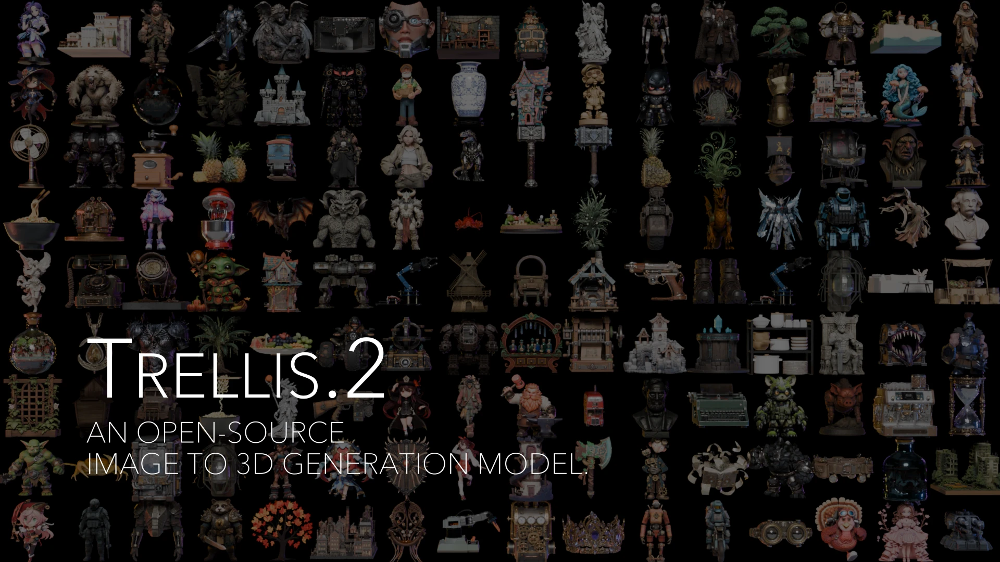

# SegviGen-Emission

The SegviGen-Emission baseline of LightGen (emission textures for 3D objects): SegviGen's 3D segmentation model,
finetuned to predict which surface voxels of a shape emit light, from its geometry, its PBR material and a
thumbnail. It is built on TRELLIS.2 (its structured latents, encoders and decoders); upstream's README follows below.

## Training on LightgenBench

The released dataset is [3dlg-hcvc/LightgenBench](https://huggingface.co/datasets/3dlg-hcvc/LightgenBench). Its
geometry comes from the TexVerse GLBs, so the input step also needs TexVerse and a checkout of the LightGen
repository (whose mesh loader built the release). Environment: TRELLIS.2's (`setup.sh`: Python 3.10, torch 2.6 +
CUDA 12.4, flash-attn, flex_gemm, o_voxel) with lightning 2.6; the conditioning step needs a transformers that loads
BiRefNet (4.57 does, 5.1 does not). `PYTHON=` selects the interpreter for each call.

```bash
# 0. the release: download (gated: accept the terms, huggingface-cli login), check, unpack, index
bash script/lightgenbench/prepare_lightgenbench.sh <download_dir> <data_root>
# 1. the inputs (resumable; NUM_GPUS GPUs, default 4)
TEXVERSE_1K=<dir> bash script/lightgenbench/run_chain.sh latents <data_root>   # dual grid, shape + PBR latents
bash script/lightgenbench/run_chain.sh masks <data_root>                        # emission-mask latents
bash script/lightgenbench/run_chain.sh cond <data_root>                         # DINOv3 conditioning, then the check
# 2. training: the init, then the release recipe (50,000 steps, 4 GPUs x 12); RESUME=1 continues a run
bash script/lightgenbench/run_chain.sh train <data_root>
```

## Prediction on LightgenBench

```bash
# emission masks on the test split, seeds 0-4 as the release was scored; CKPT is always named
CKPT=outputs/segvigen_emissive_256_release/ckpts/<checkpoint>.ckpt bash script/lightgenbench/run_chain.sh predict <data_root>
```

Each seed writes `outputs/predict_test/seed<N>/mask/draw0/<uuid>.npz` (the predicted mask on the 256 grid) and `seed<N>/ma/draw0/` (mask ×
the asset's albedo). The LightGen repository's point-sampled evaluator (`evaluation/pointsampled/pipeline.py --mode eval
--gt_emission texture_only --voxel_pred_root <dir>`) scores the masks for IoU and the mask × albedo outputs for MAE and
PSNR. The release run scored step 44,722, picked on the validation split: test IoU 0.1468 ± 0.0083 over the five seeds.

## Credits

SegviGen (MIT License, Copyright (c) 2026 Lin Li): the model design, the `full_seg` checkpoint
(Hugging Face `fenghora/SegviGen`) and the thumbnail preprocessing in `data_toolkit/thumbnail_cond.py`.
TRELLIS.2 (MIT): everything upstream; cite it as below.

---

*Upstream TRELLIS.2 README:*



To prepare datasets locally, place data under `datasets/` (or pass an explicit dataset path/object via `--data_dir` during training).

# Native and Compact Structured Latents for 3D Generation

<a href="https://arxiv.org/abs/2512.14692"></a>
<a href="https://huggingface.co/microsoft/TRELLIS.2-4B"></a>
<a href="https://huggingface.co/spaces/microsoft/TRELLIS.2"></a>
<a href="https://microsoft.github.io/TRELLIS.2"></a>
<a href="LICENSE"></a>

https://github.com/user-attachments/assets/63b43a7e-acc7-4c81-a900-6da450527d8f

*(Compressed version due to GitHub size limits. See the full-quality video on our project page!)*

**TRELLIS.2** is a state-of-the-art large 3D generative model (4B parameters) designed for high-fidelity **image-to-3D** generation. It leverages a novel "field-free" sparse voxel structure termed **O-Voxel** to reconstruct and generate arbitrary 3D assets with complex topologies, sharp features, and full PBR materials.


## ✨ Features

### 1. High Quality, Resolution & Efficiency
Our 4B-parameter model generates high-resolution fully textured assets with exceptional fidelity and efficiency using vanilla DiTs. It utilizes a Sparse 3D VAE with 16× spatial downsampling to encode assets into a compact latent space.

| Resolution | Total Time* | Breakdown (Shape + Mat) |
| :--- | :--- | :--- |
| **512³** | **~3s** | 2s + 1s |
| **1024³** | **~17s** | 10s + 7s |
| **1536³** | **~60s** | 35s + 25s |

<small>*Tested on NVIDIA H100 GPU.</small>

### 2. Arbitrary Topology Handling
The **O-Voxel** representation breaks the limits of iso-surface fields. It robustly handles complex structures without lossy conversion:
*   ✅ **Open Surfaces** (e.g., clothing, leaves)
*   ✅ **Non-manifold Geometry**
*   ✅ **Internal Enclosed Structures**

### 3. Rich Texture Modeling
Beyond basic colors, TRELLIS.2 models arbitrary surface attributes including **Base Color, Roughness, Metallic, and Opacity**, enabling photorealistic rendering and transparency support.

### 4. Minimalist Processing
Data processing is streamlined for instant conversions that are fully **rendering-free** and **optimization-free**.
*   **< 10s** (Single CPU): Textured Mesh → O-Voxel
*   **< 100ms** (CUDA): O-Voxel → Textured Mesh


## 🗺️ Roadmap

- [x] Paper release
- [x] Release image-to-3D inference code
- [x] Release pretrained checkpoints (4B)
- [x] Hugging Face Spaces demo
- [x] Release shape-conditioned texture generation inference code
- [x] Release training code


## 🛠️ Installation

### Prerequisites
- **System**: The code is currently tested only on **Linux**.
- **Hardware**: An NVIDIA GPU with at least 24GB of memory is necessary. The code has been verified on NVIDIA A100 and H100 GPUs.  
- **Software**:   
  - The [CUDA Toolkit](https://developer.nvidia.com/cuda-toolkit-archive) is needed to compile certain packages. Recommended version is 12.4.  
  - [Conda](https://docs.anaconda.com/miniconda/install/#quick-command-line-install) is recommended for managing dependencies.  
  - Python version 3.8 or higher is required. 

### Installation Steps
1. Clone the repo:
    ```sh
    git clone -b main https://github.com/microsoft/TRELLIS.2.git --recursive
    cd TRELLIS.2
    ```

2. Install the dependencies:
    
    **Before running the following command there are somethings to note:**
    - By adding `--new-env`, a new conda environment named `trellis2` will be created. If you want to use an existing conda environment, please remove this flag.
    - By default the `trellis2` environment will use pytorch 2.6.0 with CUDA 12.4. If you want to use a different version of CUDA, you can remove the `--new-env` flag and manually install the required dependencies. Refer to [PyTorch](https://pytorch.org/get-started/previous-versions/) for the installation command.
    - If you have multiple CUDA Toolkit versions installed, `CUDA_HOME` should be set to the correct version before running the command. For example, if you have CUDA Toolkit 12.4 and 13.0 installed, you can run `export CUDA_HOME=/usr/local/cuda-12.4` before running the command.
    - By default, the code uses the `flash-attn` backend for attention. For GPUs do not support `flash-attn` (e.g., NVIDIA V100), you can install `xformers` manually and set the `ATTN_BACKEND` environment variable to `xformers` before running the code. See the [Minimal Example](#minimal-example) for more details.
    - The installation may take a while due to the large number of dependencies. Please be patient. If you encounter any issues, you can try to install the dependencies one by one, specifying one flag at a time.
    - If you encounter any issues during the installation, feel free to open an issue or contact us.
    
    Create a new conda environment named `trellis2` and install the dependencies:
    ```sh
    . ./setup.sh --new-env --basic --flash-attn --nvdiffrast --nvdiffrec --cumesh --o-voxel --flexgemm
    ```
    The detailed usage of `setup.sh` can be found by running `. ./setup.sh --help`.
    ```sh
    Usage: setup.sh [OPTIONS]
    Options:
        -h, --help              Display this help message
        --new-env               Create a new conda environment
        --basic                 Install basic dependencies
        --flash-attn            Install flash-attention
        --cumesh                Install cumesh
        --o-voxel               Install o-voxel
        --flexgemm              Install flexgemm
        --nvdiffrast            Install nvdiffrast
        --nvdiffrec             Install nvdiffrec
    ```

## 📦 Pretrained Weights

The pretrained model **TRELLIS.2-4B** is available on Hugging Face. Please refer to the model card there for more details.

| Model | Parameters | Resolution | Link |
| :--- | :--- | :--- | :--- |
| **TRELLIS.2-4B** | 4 Billion | 512³ - 1536³ | [Hugging Face](https://huggingface.co/microsoft/TRELLIS.2-4B) |


## 🚀 Usage

### 1. Image to 3D Generation

#### Minimal Example

Here is an [example](example.py) of how to use the pretrained models for 3D asset generation.

```python
import os
os.environ['OPENCV_IO_ENABLE_OPENEXR'] = '1'
os.environ["PYTORCH_CUDA_ALLOC_CONF"] = "expandable_segments:True"  # Can save GPU memory
import cv2
import imageio
from PIL import Image
import torch
from trellis2.pipelines import Trellis2ImageTo3DPipeline
from trellis2.utils import render_utils
from trellis2.renderers import EnvMap
import o_voxel

# 1. Setup Environment Map
envmap = EnvMap(torch.tensor(
    cv2.cvtColor(cv2.imread('assets/hdri/forest.exr', cv2.IMREAD_UNCHANGED), cv2.COLOR_BGR2RGB),
    dtype=torch.float32, device='cuda'
))

# 2. Load Pipeline
pipeline = Trellis2ImageTo3DPipeline.from_pretrained("microsoft/TRELLIS.2-4B")
pipeline.cuda()

# 3. Load Image & Run
image = Image.open("assets/example_image/T.png")
mesh = pipeline.run(image)[0]
mesh.simplify(16777216) # nvdiffrast limit

# 4. Render Video
video = render_utils.make_pbr_vis_frames(render_utils.render_video(mesh, envmap=envmap))
imageio.mimsave("sample.mp4", video, fps=15)

# 5. Export to GLB
glb = o_voxel.postprocess.to_glb(
    vertices            =   mesh.vertices,
    faces               =   mesh.faces,
    attr_volume         =   mesh.attrs,
    coords              =   mesh.coords,
    attr_layout         =   mesh.layout,
    voxel_size          =   mesh.voxel_size,
    aabb                =   [[-0.5, -0.5, -0.5], [0.5, 0.5, 0.5]],
    decimation_target   =   1000000,
    texture_size        =   4096,
    remesh              =   True,
    remesh_band         =   1,
    remesh_project      =   0,
    verbose             =   True
)
glb.export("sample.glb", extension_webp=True)
```

Upon execution, the script generates the following files:
 - `sample.mp4`: A video visualizing the generated 3D asset with PBR materials and environmental lighting.
 - `sample.glb`: The extracted PBR-ready 3D asset in GLB format.

**Note:** The `.glb` file is exported in `OPAQUE` mode by default. Although the alpha channel is preserved within the texture map, it is not active initially. To enable transparency, import the asset into your 3D software and manually connect the texture's alpha channel to the material's opacity or alpha input.

#### Web Demo

[app.py](app.py) provides a simple web demo for image to 3D asset generation. you can run the demo with the following command:
```sh
python app.py
```

Then, you can access the demo at the address shown in the terminal.

### 2. PBR Texture Generation

Please refer to the [example_texturing.py](example_texturing.py) for an example of how to generate PBR textures for a given 3D shape. Also, you can use the [app_texturing.py](app_texturing.py) to run a web demo for PBR texture generation.


## 🏋️ Training

We provide the full training codebase, enabling users to train **TRELLIS.2** from scratch or fine-tune it on custom datasets.

### 1. Data Preparation

Before training, raw 3D assets must be converted into the **O-Voxel** representation. This process includes mesh conversion, compact structured latent generation, and metadata preparation.

> 📂 **Please refer to [data_toolkit/README.md](data_toolkit/README.md) for detailed instructions on data preprocessing and dataset organization.**

### 2. Running Training

Training is managed through the `train.py` script, which accepts multiple command-line arguments to configure experiments.
The training launcher in this release expects YAML config files (`.yaml` or `.yml`).

* `--config`: Path to the experiment configuration file.
* `--output_dir`: Directory for training outputs.
* `--load_dir`: Directory to load checkpoints from (defaults to `output_dir`).
* `--ckpt`: Checkpoint step to resume from (defaults to the latest).
* `--data_dir`: Dataset path or a JSON string specifying dataset locations.
* `--auto_retry`: Number of automatic retries upon failure.
* `--tryrun`: Perform a dry run without actual training.
* `--num_nodes`: Number of nodes for distributed training.
* `--node_rank`: Rank of the current node.
* `--num_gpus`: Number of GPUs per node (defaults to all available GPUs).
* `--master_addr`: Master node address for distributed training.
* `--master_port`: Port for distributed training communication.


### SC-VAE Training


To train the shape SC-VAE, run:

```sh
python train.py \
  --config configs/scvae/shape_vae_next_dc_f16c32_fp16.yaml \
  --output_dir results/shape_vae_next_dc_f16c32_fp16 \
  --data_dir "{\"ObjaverseXL_sketchfab\": {\"base\": \"datasets/ObjaverseXL_sketchfab\", \"mesh_dump\": \"datasets/ObjaverseXL_sketchfab/mesh_dumps\", \"dual_grid\": \"datasets/ObjaverseXL_sketchfab/dual_grid_256\", \"asset_stats\": \"datasets/ObjaverseXL_sketchfab/asset_stats\"}}"
```

This command trains the shape SC-VAE on the **Objaverse-XL** dataset using the `shape_vae_next_dc_f16c32_fp16.yaml` configuration. Training outputs will be saved to `results/shape_vae_next_dc_f16c32_fp16`.

The dataset is specified as a JSON string, where each dataset entry includes:

* `base`: Root directory of the dataset.
* `mesh_dump`: Directory containing preprocessed mesh dumps.
* `dual_grid`: Directory with precomputed dual-grid representations.
* `asset_stats`: Directory containing precomputed asset statistics.

To fine-tune the model at a higher resolution, use the `shape_vae_next_dc_f16c32_fp16_ft_512.yaml` configuration. Remember to update the `finetune_ckpt` field and adjust the dataset paths accordingly.


To train the texture SC-VAE, run:

```sh
python train.py \
  --config configs/scvae/tex_vae_next_dc_f16c32_fp16.yaml \
  --output_dir results/tex_vae_next_dc_f16c32_fp16 \
  --data_dir "{\"ObjaverseXL_sketchfab\": {\"base\": \"datasets/ObjaverseXL_sketchfab\", \"pbr_dump\": \"datasets/ObjaverseXL_sketchfab/pbr_dumps\", \"pbr_voxel\": \"datasets/ObjaverseXL_sketchfab/pbr_voxels_256\", \"asset_stats\": \"datasets/ObjaverseXL_sketchfab/asset_stats\"}}"
```


### Flow Model Training

To train the sparse structure flow model, run:

```sh
python train.py \
  --config configs/gen/ss_flow_img_dit_1_3B_64_bf16.yaml \
  --output_dir results/ss_flow_img_dit_1_3B_64_bf16 \
  --data_dir "{\"ObjaverseXL_sketchfab\": {\"base\": \"datasets/ObjaverseXL_sketchfab\", \"ss_latent\": \"datasets/ObjaverseXL_sketchfab/ss_latents/ss_enc_conv3d_16l8_fp16_64\", \"render_cond\": \"datasets/ObjaverseXL_sketchfab/renders_cond\"}}"
```

This command trains the sparse-structure flow model on the **Objaverse-XL** dataset using the specified configuration file. Outputs are saved to `results/ss_flow_img_dit_1_3B_64_bf16`.

The dataset configuration includes:

* `base`: Root dataset directory.
* `ss_latent`: Directory containing precomputed sparse-structure latents.
* `render_cond`: Directory containing conditional rendering images.


The second- and third-stage flow models for shape and texture generation can be trained using the following configurations:

* Shape flow: `slat_flow_img2shape_dit_1_3B_512_bf16.yaml`
* Texture flow: `slat_flow_imgshape2tex_dit_1_3B_512_bf16.yaml`

Example commands:

```sh
# Shape flow model
python train.py \
  --config configs/gen/slat_flow_img2shape_dit_1_3B_512_bf16.yaml \
  --output_dir results/slat_flow_img2shape_dit_1_3B_512_bf16 \
  --data_dir "{\"ObjaverseXL_sketchfab\": {\"base\": \"datasets/ObjaverseXL_sketchfab\", \"shape_latent\": \"datasets/ObjaverseXL_sketchfab/shape_latents/shape_enc_next_dc_f16c32_fp16_512\", \"render_cond\": \"datasets/ObjaverseXL_sketchfab/renders_cond\"}}"

# Texture flow model
python train.py \
  --config configs/gen/slat_flow_imgshape2tex_dit_1_3B_512_bf16.yaml \
  --output_dir results/slat_flow_imgshape2tex_dit_1_3B_512_bf16 \
  --data_dir "{\"ObjaverseXL_sketchfab\": {\"base\": \"datasets/ObjaverseXL_sketchfab\", \"shape_latent\": \"datasets/ObjaverseXL_sketchfab/shape_latents/shape_enc_next_dc_f16c32_fp16_512\", \"pbr_latent\": \"datasets/ObjaverseXL_sketchfab/pbr_latents/tex_enc_next_dc_f16c32_fp16_512\", \"render_cond\": \"datasets/ObjaverseXL_sketchfab/renders_cond\"}}"
```

Higher-resolution fine-tuning can be performed by updating the `finetune_ckpt` field in the following configuration files and adjusting the dataset paths accordingly:

* `slat_flow_img2shape_dit_1_3B_512_bf16_ft1024.yaml`
* `slat_flow_imgshape2tex_dit_1_3B_512_bf16_ft1024.yaml`


## 🧩 Related Packages

TRELLIS.2 is built upon several specialized high-performance packages developed by our team:

*   **[O-Voxel](o-voxel):** 
    Core library handling the logic for converting between textured meshes and the O-Voxel representation, ensuring instant bidirectional transformation.
*   **[FlexGEMM](https://github.com/JeffreyXiang/FlexGEMM):** 
    Efficient sparse convolution implementation based on Triton, enabling rapid processing of sparse voxel structures.
*   **[CuMesh](https://github.com/JeffreyXiang/CuMesh):** 
    CUDA-accelerated mesh utilities used for high-speed post-processing, remeshing, decimation, and UV-unwrapping.


## ⚖️ License

This model and code are released under the **[MIT License](LICENSE)**.

Please note that certain dependencies operate under separate license terms:

- [**nvdiffrast**](https://github.com/NVlabs/nvdiffrast): Utilized for rendering generated 3D assets. This package is governed by its own [License](https://github.com/NVlabs/nvdiffrast/blob/main/LICENSE.txt).

- [**nvdiffrec**](https://github.com/NVlabs/nvdiffrec): Implements the split-sum renderer for PBR materials. This package is governed by its own [License](https://github.com/NVlabs/nvdiffrec/blob/main/LICENSE.txt).

## 📚 Citation

If you find this model useful for your research, please cite our work:

```bibtex
@article{
    xiang2025trellis2,
    title={Native and Compact Structured Latents for 3D Generation},
    author={Xiang, Jianfeng and Chen, Xiaoxue and Xu, Sicheng and Wang, Ruicheng and Lv, Zelong and Deng, Yu and Zhu, Hongyuan and Dong, Yue and Zhao, Hao and Yuan, Nicholas Jing and Yang, Jiaolong},
    journal={Tech report},
    year={2025}
}
```
